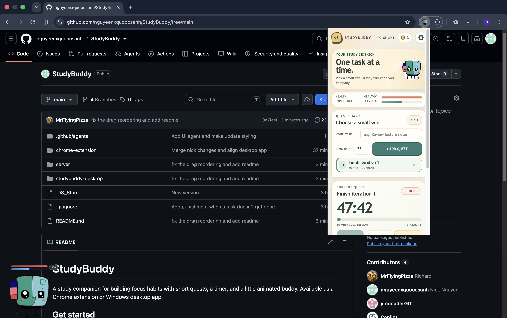

# StudyBuddy

A study companion for building focus habits with short quests, a timer, and a little animated buddy. Available as a Chrome extension or Windows desktop app.

## Get started

- **Chrome:** Open `chrome://extensions`, enable Developer mode, and choose **Load unpacked** → `chrome-extension`.
- **Desktop:** From PowerShell, run `cd .\studybuddy-desktop` then `npm run start`.

Both apps support a reorderable task queue, light/dark themes, health and XP progression, and coin rewards.

## Buddy Chat (optional)

Chat uses a local Gemini API server. From the project root, run:

```powershell
python -m pip install -r server\requirements.txt
$env:GEMINI_API_KEY = "your Gemini API key"
python -m uvicorn main:app --app-dir server --host 127.0.0.1 --port 8000
```

Keep the server running while chatting. The key stays in the server environment.


